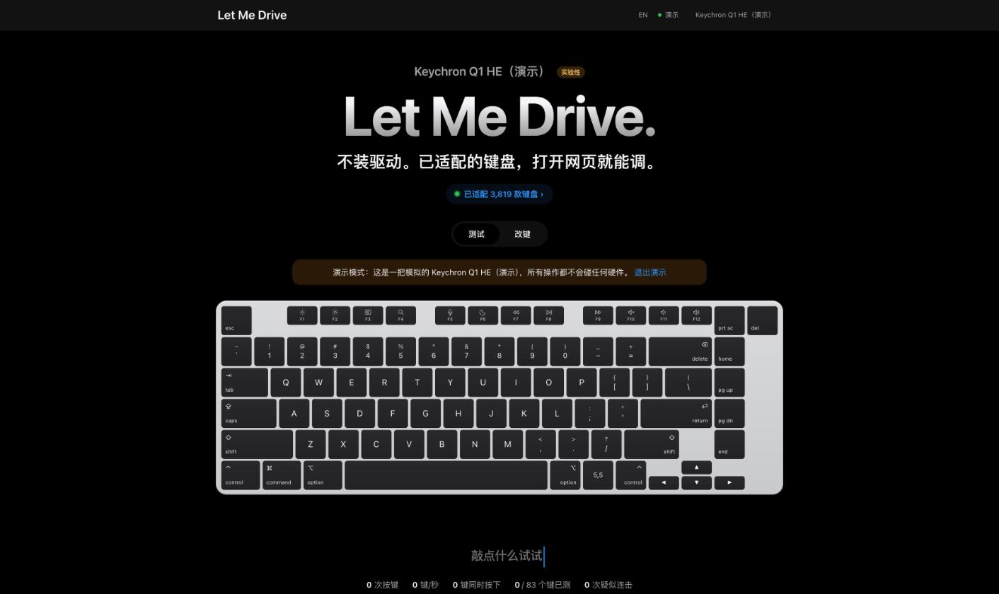

# Let Me Drive

**Plug in your keyboard. Open a web page. Tune it.**

A keyboard driver that lives in your browser. Remap keys, record macros and change lighting from Chrome or Edge — on macOS or Windows, with no vendor software to install.

[Open Let Me Drive](https://letmedrive.cn) · [Supported keyboards](https://letmedrive.cn/keyboards) · [Request a keyboard](https://github.com/tainanzhui/letmedrive/issues/new?template=support-request.yml) · [Report a problem](https://github.com/tainanzhui/letmedrive/issues/new?template=bug.yml) · [中文](README.md)

## Why

Plenty of keyboard software is Windows-only, runs a background service just to change one key, and has to be reinstalled on every new computer. Browsers can now talk to keyboards directly over WebHID, so Let Me Drive moves the whole thing into a web page. Changes are written to the keyboard itself, so they follow it to any computer.

## What it does

- **Remap** any key to another key, a shortcut, media and mouse keys, or a macro
- **Macros**: record a sequence and bind it to a key
- **Lighting**: effects, colour, brightness, speed; per-key colour on some models
- **Hall-effect boards**: actuation point, rapid trigger and advanced keys, where the model supports them
- **Key tester** with heat map and chatter detection
- **Demo mode** to try it without a keyboard

## Supported keyboards

195 brands and 3,800+ models, including Keychron, Royal Kludge, AJAZZ, Aula, Akko / MonsGeek, Wooting, DrunkDeer, NuPhy, Razer, Logitech, Corsair, SteelSeries, ASUS ROG, Ducky, REALFORCE and QMK / VIA boards. Full list: [letmedrive.cn/keyboards](https://letmedrive.cn/keyboards).

## How to use

1. Connect the keyboard with a cable (some models also work over their wireless receiver).
2. Open [letmedrive.cn](https://letmedrive.cn) in desktop **Chrome** or **Edge**.
3. Click **Connect** and pick your keyboard; the model is detected automatically.

## Privacy

Everything happens in your browser and is written straight to the keyboard. Nothing is uploaded and no account is needed.

## Limitations

Desktop Chrome or Edge is required — Safari, Firefox and mobile browsers don't support WebHID. Models marked "experimental" are still being completed. Some wireless boards can only be configured when wired or on their receiver.

## About

Let Me Drive is a personal project and is not affiliated with any keyboard manufacturer; all trademarks belong to their owners. Changing keyboard settings carries some risk — a factory reset from the vendor's tool or the keyboard's own key combo restores it. This repository is for releases and feedback; the source code is not public.
