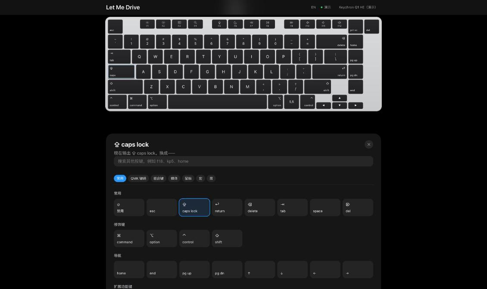
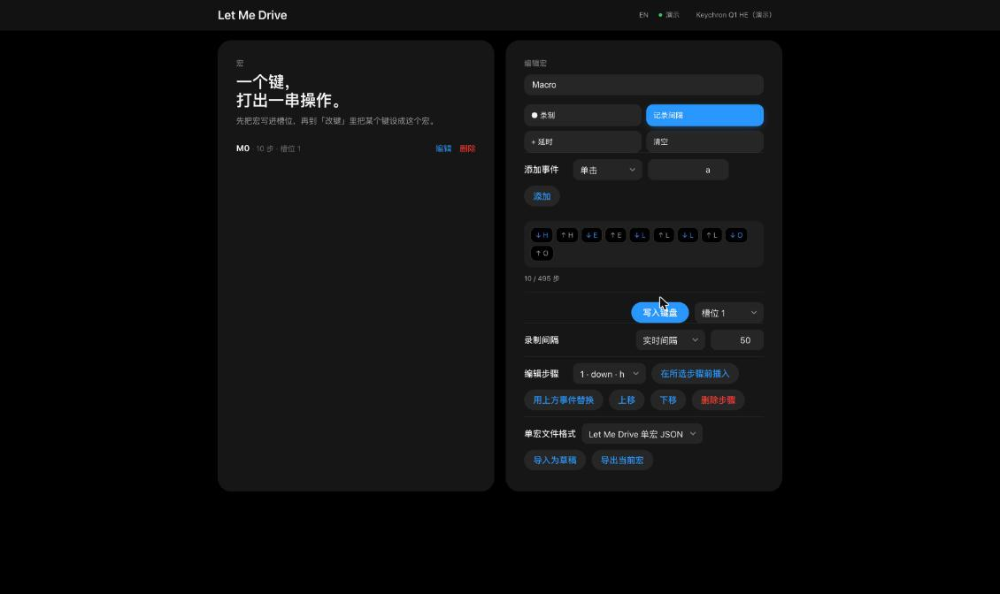
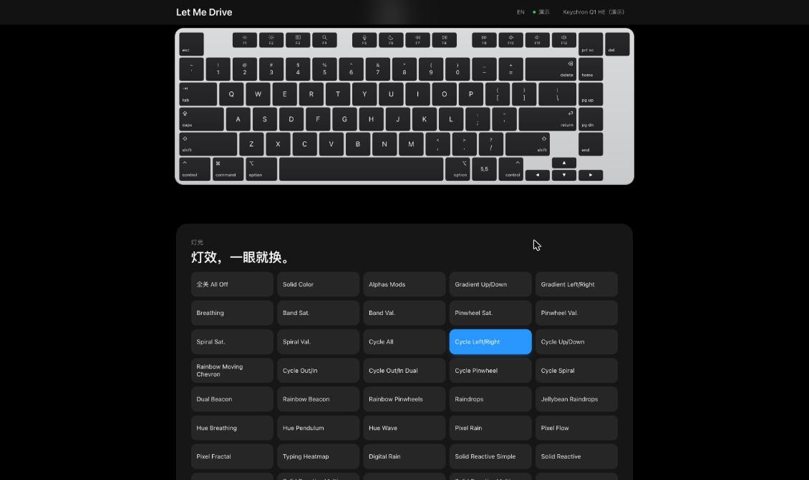
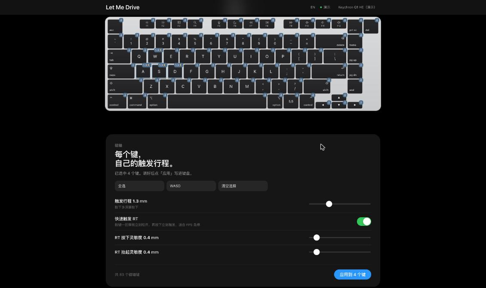
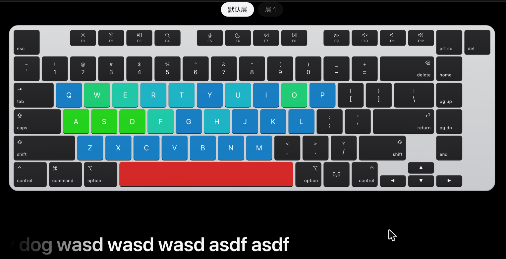

# Let Me Drive

### 网页键盘驱动大合集

在浏览器里改键、录宏、调灯光，设置磁轴触发参数。

**简体中文** · [English](README.en.md)

[开始使用](https://letmedrive.cn) · [查找键盘](https://letmedrive.cn/keyboards) · [使用指南](docs/guide.zh-CN.md) · [反馈问题](https://github.com/MukiCheung/letmedrive/issues/new?template=bug.yml)

[快速开始](#快速开始) · [功能](#功能) · [兼容性](#兼容性) · [常见问题](#常见问题) · [参与反馈](#参与反馈)

## 关于项目

Let Me Drive 是一个浏览器里的键盘配置工具，把多个品牌的配置功能放到同一个界面。支持的键盘可以在 Windows 和 macOS 上通过 Chrome 或 Edge 连接，不需要另外安装本项目的桌面客户端。

连接后，网页通过 WebHID 与键盘通信。能调整哪些选项、如何保存，取决于具体型号和固件。

**本仓库用于产品介绍、使用文档和问题反馈。应用目前免费使用，应用源代码未在本仓库公开。**

## 快速开始

1. **查型号**：在[键盘列表](https://letmedrive.cn/keyboards)确认具体型号和连接方式。
2. **接键盘**：优先使用 USB 数据线；接收器支持情况按型号查看。
3. **打开网页**：用电脑上的 Chrome 或 Edge 访问 [letmedrive.cn](https://letmedrive.cn)。
4. **授权连接**：点击「连接键盘」，在浏览器设备列表里选择对应设备。
5. **修改并验证**：先改一个键或一种灯效，按页面提示保存，再检查实际效果。

没有键盘在手边？可以先在首页打开演示，看看操作界面。

[查看连接、保存和排查指南 →](docs/guide.zh-CN.md)

## 功能

以下是产品提供的功能类别。具体键盘会按其支持能力显示选项。

<table>
<tr>
<td width="50%">
<h3>改键与分层</h3>

在键盘图上选择按键，设置普通键、组合键、媒体键、鼠标操作或层切换。

</td>
<td width="50%">
<h3>宏录制与编辑</h3>

录制输入，调整按下、松开和延时，再将宏绑定到按键；支持导出备份。

</td>
</tr>
<tr>
<td>
<h3>灯光</h3>

调整灯效、颜色、亮度和速度。支持逐键灯光的型号可单独设置按键颜色。

</td>
<td>
<h3>磁轴与快速触发</h3>

在支持的磁轴键盘上调整触发行程、Rapid Trigger 和按下、抬起灵敏度。

</td>
</tr>
</table>

| 功能 | 用途 |
| --- | --- |
| 高级键 | 在支持的型号上配置 DKS、轻按 / 长按和切换行为 |
| 板载参数 | 调整型号开放的回报率、防抖、休眠时间、Win 键锁等设置 |
| 配置备份 | 导出配置，保留调整记录；导入前核对型号和配置格式 |
| 按键测试 | 查看按键响应、按压次数和连击检测结果 |

查看按键测试界面

## 兼容性

| 环境 | 使用说明 |
| --- | --- |
| Windows / macOS | 使用桌面版 Chrome 或 Edge |
| Safari / Firefox / 手机浏览器 | 不作为当前配置工具的支持环境 |
| USB 有线 | 建议首先尝试的连接方式 |
| 2.4 GHz 接收器 | 取决于型号与接收器协议 |
| 蓝牙 | 不保证可用于配置；优先切换有线模式 |

型号目录包含 Keychron、Royal Kludge、AJAZZ、Aula、Akko / MonsGeek、NuPhy、MCHOSE、Wooting、DrunkDeer、Dygma、8BitDo 等品牌，以及部分 QMK / VIA / Vial 键盘。**同品牌不等于全型号支持，同型号不同固件也可能有差异。**

以[在线键盘目录](https://letmedrive.cn/keyboards)中的具体条目和连接后的功能显示为准。标为「实验性」的项目仍在完善。

### 验证范围

模拟设备的写入、读回检查用于验证协议处理逻辑；真机还涉及固件版本、连接模式和设备实际响应。模拟测试通过不等于对应型号的所有真机均已验证。反馈时附上具体型号和固件信息，可以帮助定位差异。

## 常见问题

<strong>这是键盘驱动，还是网页工具？</strong>

它是网页配置工具。键盘日常输入仍由操作系统的 HID 支持处理；网页负责读取和修改设备支持的配置，不替换操作系统驱动。

<strong>关闭网页后，设置还在吗？</strong>

支持板载保存的设置可保存在键盘中。具体保存行为取决于型号；按页面提示完成写入后，可以断开重连检查。重要配置先导出备份。

<strong>连接列表里没有键盘，怎么办？</strong>

先确认使用 Chrome 或 Edge 和可传输数据的 USB 线，切换到有线模式，并关闭可能占用设备的官方配置工具。更多步骤见[使用指南](docs/guide.zh-CN.md#连接排查)。

<strong>找不到型号，或者某项功能不正常？</strong>

找不到型号可[提交适配需求](https://github.com/MukiCheung/letmedrive/issues/new?template=support-request.yml)；已连接但行为异常可[反馈问题](https://github.com/MukiCheung/letmedrive/issues/new?template=bug.yml)。请提供完整型号、系统、浏览器、连接方式和复现步骤。

## 参与反馈

- [报告问题](https://github.com/MukiCheung/letmedrive/issues/new?template=bug.yml)：描述操作步骤、预期效果和实际结果。
- [申请型号适配](https://github.com/MukiCheung/letmedrive/issues/new?template=support-request.yml)：提供完整型号、官方产品页或配置工具链接。
- [改进文档](CONTRIBUTING.md)：欢迎纠错、翻译和补充经过实际使用验证的说明。

由 [Muki Cheung](https://github.com/MukiCheung) 维护。项目与文中键盘厂商无隶属关系，品牌与商标归各自所有。
